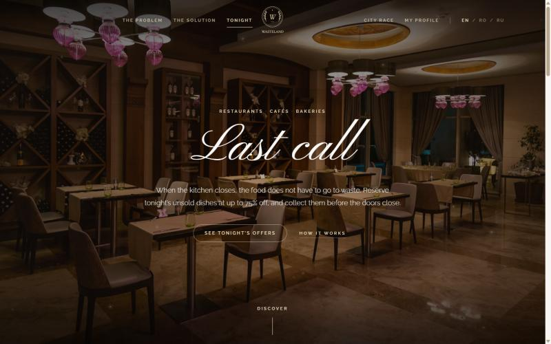
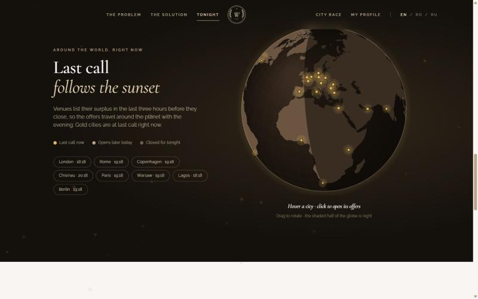
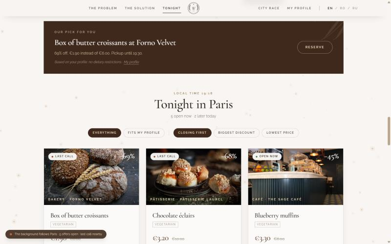
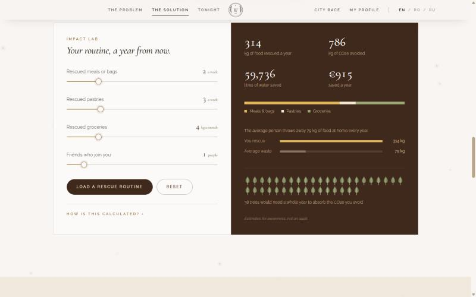
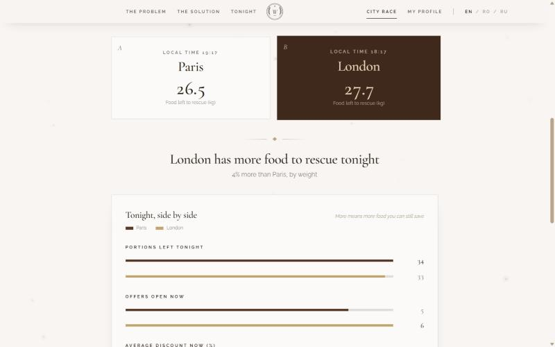
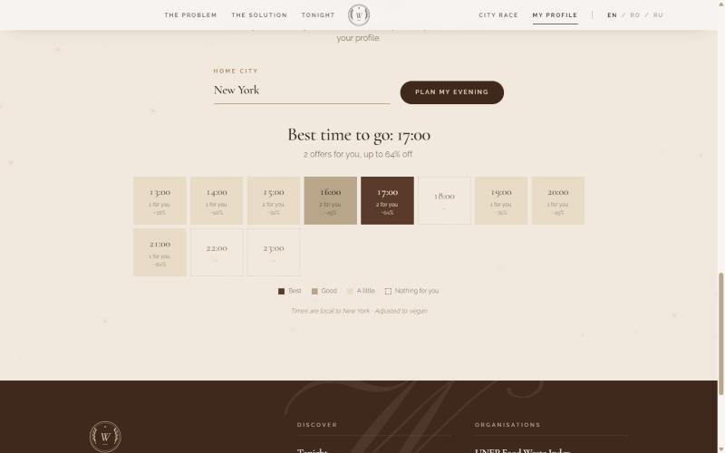

# 🥐 WasteLand

**Every evening, perfectly good food is thrown away because the doors are about to close.** WasteLand lists the unsold dishes of restaurants, cafés, bakeries and fine grocers in the last three hours before closing, at a price that falls as closing time approaches. You pay less for the same food, the venue recovers its costs instead of paying to bin it, and the planet is spared the waste: a win, win, win.

Project submitted to Infomatrix, category **Software Development** (Project Contest).

---

## 1. Project Description

### The problem

- **1.05 billion tonnes** of food were wasted in 2022, about 132 kg per person ([UNEP Food Waste Index Report 2024](https://www.unep.org/resources/publication/food-waste-index-report-2024))
- **19%** of the food available to consumers ends up in the bin; food service alone (restaurants, cafés, canteens) wastes about **290 million tonnes** a year (UNEP, 2024)
- **8–10%** of global greenhouse-gas emissions come from food that is lost or wasted (UNEP, 2024), while **783 million** people were affected by hunger in 2022

The food is there. It is baked at dawn, plated at noon and still perfectly good at closing time. Kitchens must cook before they know how many guests will come, and at closing time unsold food has nowhere to go: most of it cannot be kept until tomorrow, and donating it takes time and logistics a small kitchen does not have. Customers have no way of knowing what is left, where, and that it could be theirs for a fraction of the price.

### The solution

WasteLand connects the last hours of a kitchen's day with people nearby:

1. **Live offers in 28 cities.** Each partner venue lists its surplus in the three hours before it closes, in the city's own time zone and currency, with the pickup window and the portions left.
2. **Prices that fall with the evening.** Dynamic "last call" pricing goes from 30% off when a pickup window opens to 70% off at closing, plus up to 5 extra points when much of a batch is still unsold late in the window. All prices are computed on the server.
3. **Reservations with a pickup code.** You choose your portions, the server locks the current price, takes the portions off the listing and returns a code to show at the counter. Payment happens at the counter.
4. **A personal profile.** Vegetarian, vegan, gluten-free, on a budget, last-call alerts. The listing can be filtered to what fits you.
5. **A recommendation, not just a list.** "Box of butter croissants at Forno Velvet, 69% off, pickup until 19:30" instead of a wall of cards. On a budget it picks the cheapest share of the full price; otherwise the deepest discount; ties go to whatever closes first.
6. **Proactive alerts.** A browser notification when an offer that fits your profile enters its last 45 minutes.
7. **A globe that follows the sunset.** The 28 partner cities glow gold where last call is happening right now, and the night half of the planet is shaded using the real position of the sun. You can drag to rotate, hover for the local time, and click to open a city's offers. It is drawn from scratch on a `<canvas>` with an orthographic projection.
8. **A background that follows the evening.** Golden motes drift over the page. The more offers are open in the last city you looked at, the more motes there are, and they warm toward copper when food nearby is at last call.
9. **The last seven evenings.** Portions rescued per day in the city, drawn as an animated, hoverable SVG chart.
10. **City race.** Compare two cities, metric by metric: portions left, offers open, average discount, kg left to rescue and the CO2e that rescuing it avoids.
11. **Impact lab.** Four sliders (meals or bags, pastries, groceries, friends who join you) turn a weekly habit into a year of food rescued, CO2e and water avoided, money saved, and a small forest of trees, compared with the 79 kg of food the average person throws away at home.
12. **Your evening, hour by hour.** Enter a home city (remembered on the device) and the rest of today is drawn as hourly tiles, coloured for your diet and budget, with the best hour to go.
13. **Live global context.** A counter of the tonnes of food wasted worldwide since you opened the page (at the 2022 rate of about 33 t/s) and the years left to the UN goal of halving food waste by 2030.
14. **Links to real organisations.** UNEP Food Waste Index, FAO, WRAP.

Available in **English, Romanian and Russian**.

> **Honesty note.** WasteLand is a student project. The partner venues and their offers are a **simulated demo network**: a deterministic catalogue generated on the server. Prices, timings, time zones and currencies all behave as they would for real venues, and reservations are real requests to our server, but no real restaurant is involved and no payment is taken. The site says this on the home page.

### Screenshots



*The home page opens on a full-bleed photograph and a script headline, in the style of a luxury-hotel site.*



*Last call follows the sunset. Gold cities are at last call now, and the shaded half of the globe is night.*



*Tonight in Paris: one personal pick, then every offer with its urgency, discount, pickup window and portions left.*



*Impact lab: a weekly habit turned into a year of rescued food, CO2e, water, money and trees.*



*City race: which city has more food waiting to be rescued tonight.*



*Your evening, hour by hour, coloured for a vegan profile, with the best time to go.*

---

## 2. People Involved

| Role | Name |
|---|---|
| Student developer | Mihai Chircu |
| Supervisor | Azamat Jayush |

Team size: 1 student (solo entry), within the category's 1–2 student limit.

---

## 3. Early-Stage Plan, Design Decisions & Timeline

The project started from one framing question: *how do you make "food waste", a global statistic, into something one person can act on tonight?* Three early decisions followed from it:

1. **Make the moment the product.** Food is wasted at a precise time, closing time, so everything is organised around the pickup window: urgency badges, countdowns, prices that fall toward closing, alerts in the last 45 minutes, and a globe that shows where that moment is happening on the planet.
2. **Win, win, win, or it does not work.** The customer must save real money, the venue must recover real costs, and the planet must avoid real emissions. Every screen shows all three: the price, what the venue would otherwise bin, and the kg and CO2e rescued.
3. **The server is the source of truth for prices.** A marketplace whose prices are calculated in the browser can be cheated by editing a request. The architecture was split into a frontend and a small backend from the first design pass, and the backend recomputes every price at the moment of reservation.

The structure deliberately mirrors the author's earlier project, ClimaWatch: the same pages (Problem, Solution, Live, Compare, Profile), the same serverless backend with a local emulator, the same three languages, and the same habit of testing every piece of logic. The visual design is new: a warm cream, cocoa and champagne-gold palette, Cormorant Garamond headings with a script display face, full-bleed photography and tracked uppercase labels, inspired by luxury-hotel websites.

### Development timeline

| Date | What happened |
|---|---|
| **18 Oct 2026** | **First complete version.** React + TypeScript frontend and a serverless backend with five endpoints (offers, history, evening, cities, reserve). Deterministic partner catalogue for 28 cities, time-zone-aware dynamic pricing, reservations with pickup codes, profile-based recommendations and alerts, night-side globe, impact lab, city race, hour-by-hour planner, EN/RO/RU translations, and 91 automated tests. |

---

## 4. Architecture

```
Browser (React)                    Server (serverless functions)
┌──────────────────────┐           ┌──────────────────────────────────┐
│  utils/foodApi.ts     │  fetch    │  api/offers.ts         (a city)  │
│  GET  /api/offers     │ ────────▶ │  api/offer-history.ts  (7 days)  │
│  GET  /api/offer-…    │           │  api/evening.ts        (by hour) │
│  GET  /api/evening    │           │  api/cities.ts         (globe)   │
│  GET  /api/cities     │           │  api/reserve.ts        (POST)    │
│  POST /api/reserve    │           │              │                   │
└──────────────────────┘           │              ▼                   │
                                    │  api/_lib/  catalog (28 cities,  │
                                    │  8 venues each), clock (time     │
                                    │  zones), pricing, offers,        │
                                    │  reservations                    │
                                    └──────────────────────────────────┘
```

- **Prices are never trusted from the browser.** The client sends only *which* offer and *how many*; `reserveOffer` recomputes the price from the server clock and the venue's time zone. A test sends a fake price of 0.01 and checks that it is ignored.
- **Every city runs on its own clock.** `localClock` reads the wall time in the city's IANA time zone, so the same instant is last call in Bucharest and breakfast in Tokyo.
- **Deterministic catalogue.** Venues and daily batches come from a seeded random generator (`mulberry32` over an FNV-1a hash of `venue|slot|date`), so every visitor sees the same offers, finished days never change, and tests can assert exact values.
- In **production** (Vercel), each `api/*.ts` file runs as a serverless function. In **local development**, `vite-plugins/localApi.ts` mounts the very same handlers on Vite's dev server.
- The history, evening and globe endpoints send `Cache-Control: s-maxage` headers; the offers and reservation endpoints are never cached, because prices change minute by minute.

---

## 5. Software & Hardware Specifications

| | |
|---|---|
| Frontend | React 19, TypeScript, Vite, Tailwind CSS v4, React Router |
| Backend | Serverless functions (Node.js, Vercel function format) |
| Translations | Custom React context (EN/RO/RU), no external library |
| Typography | Cormorant Garamond, Pinyon Script, Raleway (Google Fonts) |
| Globe | HTML canvas + [d3-geo](https://github.com/d3/d3-geo) (orthographic projection, `geoCircle` for the night side) + [world-atlas](https://github.com/topojson/world-atlas) / [topojson-client](https://github.com/topojson/topojson-client); lazy-loaded as its own chunk |
| Charts and animation | Hand-written SVG (smooth Bézier history chart) and canvas (golden motes); no charting library |
| Food-waste chart | [Our World in Data](https://ourworldindata.org/grapher/food-waste-per-capita) (live embed) |
| Video | [TED](https://www.ted.com/), Tristram Stuart, "The global food waste scandal" |
| Photography | [Unsplash](https://unsplash.com/) (Unsplash License), served through Unsplash's image CDN |
| Testing | Vitest |
| Hardware | None. WasteLand is a web application that runs in any modern browser on any device with an internet connection. |

### Project structure

```
src/
  components/     UI (PageHero, Navbar, Footer, OfferCard, ReserveDialog, RescueGlobe, EveningBackground,
                  HistoryChart, ImpactLab, EveningPlanner, embeds…)
  pages/          Problem, Solution, Tonight (home), City race, My profile
  hooks/          useOffers, useCompare, useEveningPlanner, useProfile, useOrders, useCountUp
  context/        EveningMood (shares the last city looked at with the background)
  i18n/           EN/RO/RU translations + language context
  utils/          API client, recommendations, comparison, impact, planner, mood, sun position, formatting
  constants/      Urgency levels and colours, photography
api/
  offers.ts, offer-history.ts, evening.ts, cities.ts, reserve.ts   Serverless functions (deployable)
  _lib/                                                            Shared backend logic + tests
vite-plugins/
  localApi.ts     Serves the same handlers in local development
```

---

## 6. Problems Faced & How They Were Solved

- **A marketplace can be cheated from the browser.** If the client computed or sent the price, anyone could reserve a tart for 0.01. *Solution:* the client sends only an offer id and a quantity; `reserveOffer` rebuilds the offer from the server clock and charges that price. Tested in `reserveOffer.test.ts`, including a request that tries to send its own price.
- **"Tonight" is different in every city.** A single server clock would open Tokyo's restaurants at Bucharest's dinner time. *Solution:* every city carries its IANA time zone; `localClock` reads the wall time there with `Intl.DateTimeFormat`, offer ids include the local date, and an offer from another day is rejected with `410 Gone`. Tested across Bucharest, Tokyo and New York at the same instant.
- **Demo data that must behave like real data.** Random offers would change on every refresh and could not be tested. *Solution:* a seeded generator makes venues stable per city and batches stable per venue, slot and date; portions sold by others follow the time elapsed in the window; finished days in the history never change. All of this is unit-tested.
- **A fair price curve.** A discount that jumps or decreases would confuse people. *Solution:* `discountFor` rises smoothly from 30% to 70% (`p^1.3`, slow at first, faster near the end) with a bounded leftover boost; tests check it never decreases, is clamped, and always makes the price strictly cheaper than the original.
- **Two people reserving the last portion.** *Solution:* the server re-checks the portions left at the moment of reservation and answers `409 Conflict` when there are not enough; the dialog explains that someone was quicker and the listing refreshes. *Known limit:* reservations are kept in the memory of the serverless instance, so they reset when it restarts; a production version would store them in a database.
- **A recommendation people can trust.** "Best" means different things on a budget and off one. *Solution:* `getRecommendation` filters by diet (vegan implies vegetarian), prefers open offers over upcoming ones, ranks by share of the full price on a budget or by discount otherwise, and breaks ties by what closes first. Every rule is covered in `recommendations.test.ts`.
- **Showing night on the globe without an astronomy library.** *Solution:* `utils/sun.ts` computes the sub-solar point from the date (solar declination and UTC hour); the night side is a `geoCircle` of radius 90° around its antipode, recomputed every minute. Tested for noon at Greenwich, the hourly 15° shift and the solstices.
- **Prices in 22 currencies.** 4.47 lei, 742 yen and 12 345 won need different rounding. *Solution:* `niceRound` rounds to two significant steps of each price's own magnitude, and `formatMoney` uses `Intl.NumberFormat` with whole units above 100.
- **Decorative animation that should not hurt users.** *Solution:* the golden motes are capped at 160, limit canvas pixel density and ease toward each new state; the globe pauses when off screen; every animation respects the browser's "reduce motion" setting.
- **A luxury look that still works on a phone.** *Solution:* the split navigation collapses into a full-screen menu, heroes use `svh` units, grids reflow to one column, the globe uses `touch-action: pan-y` so vertical swipes still scroll the page, and the layout was checked at 375 px with no horizontal scroll.

---

## 7. Responsible AI Usage

AI tools were used during development, in line with the category's rules on citing AI assistance.

- **Tool used:** [Claude Code](https://claude.com/claude-code) (Anthropic), an AI coding assistant, used as a pair-programming tool.
- **How it was used:** scaffolding the project on the structure of the student's earlier project, writing frontend and backend TypeScript, generating the automated tests, translating the interface, and drafting this README, from directions and requirements given by the student.
- **Human oversight:** generated code is reviewed, run and tested before being kept. Product decisions (the problem, the win-win-win model, the visual direction, what the architecture must protect against) were directed by the student.
- **What was not AI-generated:** the food-waste statistics and their sources, the Our World in Data chart, the TED talk and the Unsplash photographs are real external sources, credited below.

No AI-generated text, image or code in this project is presented as original human work without this disclosure.

---

## Running locally

```bash
npm install
npm run dev
```

No API key or `.env` file is needed: the backend runs entirely on its own catalogue.

## Testing

```bash
npm test
```

91 tests cover the backend (catalogue and city lookup, time zones, the price curve and rounding, offer status across the evening, reservations and every error case, history, the hourly evening view and the globe pulse) and the frontend logic (recommendations for every diet, the planner, the city comparison, the impact calculator, the background mood, urgency levels, the sun position and formatting).

## Deployment

The `api/*.ts` structure is recognised automatically by [Vercel](https://vercel.com): import the repository and deploy. No environment variables are required. `vercel.json` rewrites every non-API route to `index.html`, so direct links to inner pages work.

## Sources

UNEP Food Waste Index Report 2024 (unep.org); FAO, *Food Wastage Footprint: Impacts on Natural Resources* (2013) and *The State of Food and Agriculture 2019* (fao.org); United Nations Sustainable Development Goals, target 12.3 (sdgs.un.org); Our World in Data (ourworldindata.org); WRAP (wrap.ngo); TED, Tristram Stuart; Unsplash (photography); Natural Earth coastlines (naturalearthdata.com, via the world-atlas package).

## License

[MIT](LICENSE). Open source, per Infomatrix competition rules.
