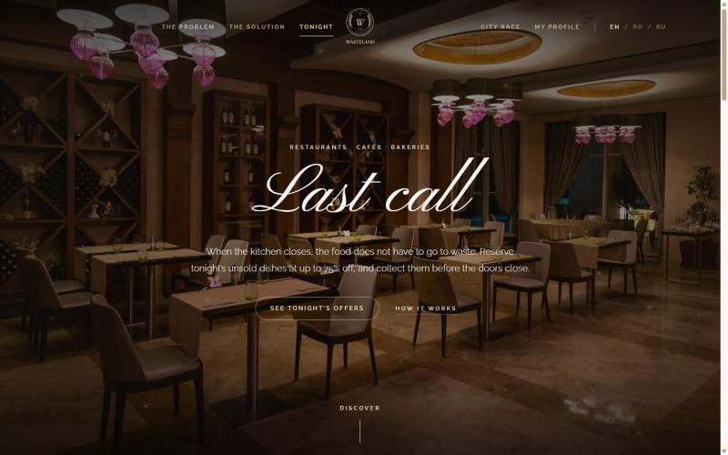
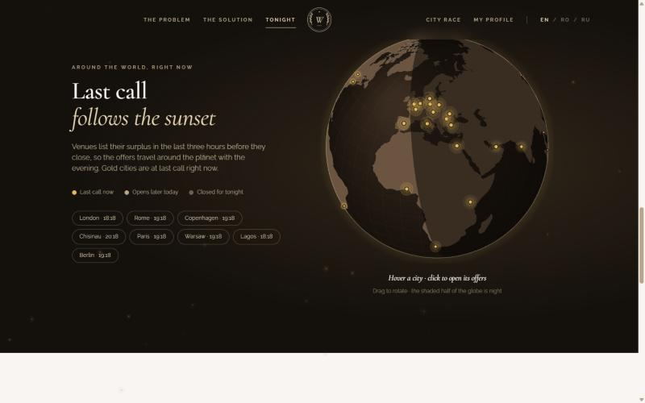
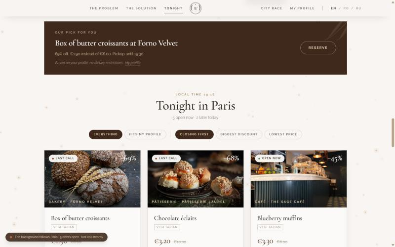
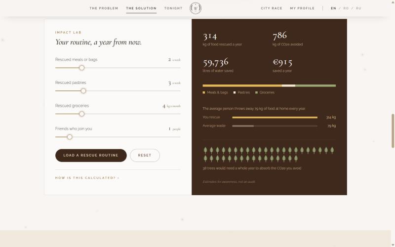
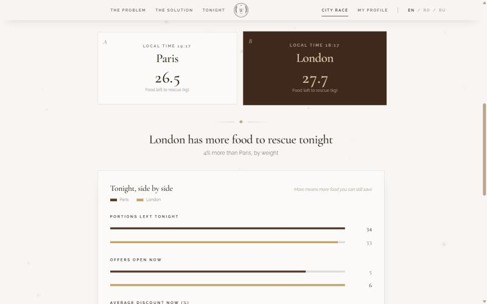
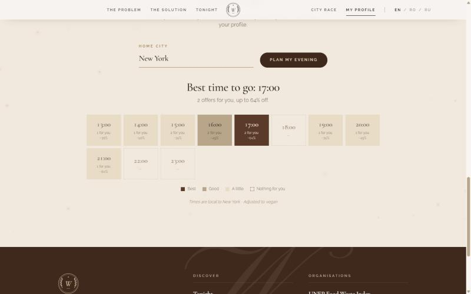
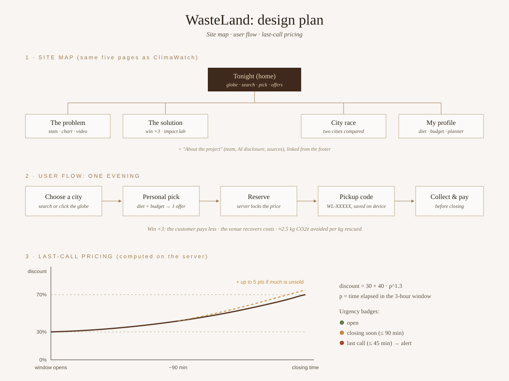

# 🥐 WasteLand

**Every evening, perfectly good food is thrown away because the doors are about to close.** WasteLand lists the unsold dishes of restaurants, cafés, bakeries and fine grocers in the last three hours before closing, at a price that falls as closing time approaches. You pay less for the same food, the venue recovers its costs instead of paying to bin it, and the planet is spared the waste: a win, win, win.

Project submitted to Infomatrix, category **Software Development** (Project Contest).

### 🔴 [Try the live app → waste-land-beta.vercel.app](https://waste-land-beta.vercel.app)

**Research:** the pricing rule is tested against two simple baselines in a pre-registered simulation (N = 18,000 venue-evenings), with a B2B return table for a bakery. Result, honestly: all four hypotheses are only **partially supported**. See [section 8](#8-research-hypothesis-benchmark-and-b2b-economics) and the live [/research](https://waste-land-beta.vercel.app/research) page. MoldSEF documents: [abstract](docs/moldsef/abstract.pdf), [visual annex](docs/moldsef/visual-annex.pdf), [logbook](docs/moldsef/logbook.md), [A0 poster](docs/poster/poster-A0.pdf), [pitch](docs/PITCH.md).

### Infomatrix requirements checklist

| Requirement (Infomatrix regulations and Software Development page) | Where it is met |
|---|---|
| Entry in English | The site opens in English by default (Romanian and Russian are optional); all documentation is in English |
| 1–2 students and a supervisor, as distinct roles | [People involved](#2-people-involved) |
| Description with sketches or images of the idea | [Screenshots](#screenshots) and the [design plan](docs/design/plan.svg) (site map, user flow, pricing curve) |
| Early-stage plans and designs | [Early-stage plan & design decisions](#3-early-stage-plan-design-decisions--timeline) |
| Iterations during development | [Development timeline](#development-timeline) and the Git history |
| Software and hardware specifications | [Specifications](#5-software--hardware-specifications) |
| Problems faced and how they were solved | [Problems faced](#6-problems-faced--how-they-were-solved) |
| Open source, original work, no third-party rights infringed | [MIT licence](LICENSE); every third-party resource and its licence is in [Third-party content](#third-party-content--licences) |
| Cite all prompts, models and AI resources | [Responsible AI](#7-responsible-ai-usage) and the full [AI usage log](docs/AI_USAGE.md) with every prompt, also linked from the site's *About the project* page |
| A real-world problem, practical and user-friendly | [The problem](#the-problem); the live app works on desktop and phone |
| *MoldSEF:* testable hypothesis, benchmark N ≥ 100, B2B economics | [Section 8](#8-research-hypothesis-benchmark-and-b2b-economics) |
| *MoldSEF:* abstract, visual annex, logbook, A0 poster draft, pitch | [Section 8.10](#810-moldsef-documents) |

## Where each evaluation criterion is met

For reviewers: every claim below points to a file or a test that can be checked, and the known weaknesses are listed in one place.

| Criterion | Where to check it |
|---|---|
| Practical and economic value | [Section 8.6](#86-b2b-return-on-investment-a-bakery-in-chișinău) (bakery return in MDL/EUR, commission comparison) and [8.7](#87-what-it-costs-to-run-wasteland) (real running cost); `src/utils/economics.ts` + tests |
| Scientific novelty and hypothesis | [Section 8.1](#81-scientific-hypothesis); [research/PREREGISTRATION.md](research/PREREGISTRATION.md) |
| Technical depth and methodology | [Sections 8.2–8.5](#82-benchmark-design-n--18000--100); `research/simulation.ts`, `research/stats.ts`, `research/benchmark.ts`, `research/results/benchmark.json`; the server code in `api/_lib/` with its tests |
| Product quality and design | The live app; [screenshots](#screenshots); responsive down to 375 px; `prefers-reduced-motion` respected |
| Responsible AI and compliance | [Section 7](#7-responsible-ai-usage); [docs/AI_USAGE.md](docs/AI_USAGE.md) (every prompt, models, what was and was not verified); [third-party licences](#third-party-content--licences) |
| Documentation and research log | [Abstract](docs/moldsef/abstract.pdf), [visual annex](docs/moldsef/visual-annex.pdf), [logbook](docs/moldsef/logbook.md) |
| Stand design and defence | [A0 poster](docs/poster/poster-A0.pdf) (with QR codes), [3-minute pitch and Q&A](docs/PITCH.md) |

**Known weaknesses, stated up front:**

* No real sales data: demand is assumed (nine scenarios, six variations); a one-bakery pilot is the missing experiment.
* All four hypotheses are only partially supported; the 1.3 exponent is a plateau, not a proven optimum; the advantage over a fixed discount disappears if no customer waits for the price to fall.
* Unverified inputs: the 25–30% commission rates (the supervisor's figures), the disposal-cost placeholder, and three literature references written from memory. (The Vercel Pro price, USD 20 a month excluding VAT, was confirmed on vercel.com/pricing on 12 November 2026 (screenshot sent by the student).)
* The pre-registration was written before the simulator but was not committed to Git before the run (its hash is stored in the results).
* Team size: a solo entry. The supervisor said this is fine (the student's word, recorded on 12 November 2026); the student carries both roles.

---

## 1. Project Description

### The problem

- **1.05 billion tonnes** of food were wasted in 2022, about 132 kg per person ([UNEP Food Waste Index Report 2024](https://www.unep.org/resources/publication/food-waste-index-report-2024))
- **19%** of the food available to consumers ends up in the bin; food service alone (restaurants, cafés, canteens) wastes about **290 million tonnes** a year (UNEP, 2024)
- **8–10%** of global greenhouse-gas emissions come from food that is lost or wasted (UNEP, 2024), while **783 million** people were affected by hunger in 2022

The food is there. It is baked at dawn, plated at noon and still perfectly good at closing time. Kitchens must cook before they know how many guests will come, and at closing time unsold food has nowhere to go: most of it cannot be kept until tomorrow, and donating it takes time and logistics a small kitchen does not have. Customers have no way of knowing what is left, where, and that it could be theirs for a fraction of the price.

### The solution

WasteLand connects the last hours of a kitchen's day with people nearby:

1. **Live offers in 28 cities.** Each partner venue lists its surplus in the three hours before it closes, in the city's own time zone and currency, with the pickup window and the portions left.
2. **Prices that fall with the evening.** Dynamic "last call" pricing goes from 30% off when a pickup window opens to 70% off at closing, plus up to 5 extra points when much of a batch is still unsold late in the window. All prices are computed on the server.
3. **Reservations with a pickup code.** You choose your portions, the server locks the current price, takes the portions off the listing and returns a code to show at the counter. Payment happens at the counter.
4. **A personal profile.** Vegetarian, vegan, gluten-free, on a budget, last-call alerts. The listing can be filtered to what fits you.
5. **A recommendation, not just a list.** "Box of butter croissants at Forno Velvet, 69% off, pickup until 19:30" instead of a wall of cards. On a budget it picks the cheapest share of the full price; otherwise the deepest discount; ties go to whatever closes first.
6. **Proactive alerts.** A browser notification when an offer that fits your profile enters its last 45 minutes.
7. **A globe that follows the sunset.** The 28 partner cities glow gold where last call is happening right now, and the night half of the planet is shaded using the real position of the sun. You can drag to rotate, hover for the local time, and click to open a city's offers. It is drawn from scratch on a `<canvas>` with an orthographic projection.
8. **A background that follows the evening.** Golden motes drift over the page. The more offers are open in the last city you looked at, the more motes there are, and they warm toward copper when food nearby is at last call.
9. **The last seven evenings.** Portions rescued per day in the city, drawn as an animated, hoverable SVG chart.
10. **City race.** Compare two cities, metric by metric: portions left, offers open, average discount, kg left to rescue and the CO2e that rescuing it avoids.
11. **Impact lab.** Four sliders (meals or bags, pastries, groceries, friends who join you) turn a weekly habit into a year of food rescued, CO2e and water avoided, money saved, and a small forest of trees, compared with the 79 kg of food the average person throws away at home.
12. **Your evening, hour by hour.** Enter a home city (remembered on the device) and the rest of today is drawn as hourly tiles, coloured for your diet and budget, with the best hour to go.
13. **Live global context.** A counter of the tonnes of food wasted worldwide since you opened the page (at the 2022 rate of about 33 t/s) and the years left to the UN goal of halving food waste by 2030.
14. **Links to real organisations.** UNEP Food Waste Index, FAO, WRAP.
15. **A page for restaurants.** A café or bakery lists tonight's surplus in a minute: city, venue name, item, portions, full price and closing time. The listing appears on the live site at once, priced by the same last-call curve, marked "Listed by the venue", and can be removed only from the device that created it.
16. **A real database.** Reservations and restaurant listings are stored in an Upstash Redis database connected through Vercel, so they survive restarts, and the last portion can never be sold twice.

Available in **English, Romanian and Russian**.

> **Honesty note.** WasteLand is a student project. So that every city has something to explore, most offers come from a **simulated demo network**: a deterministic catalogue generated on the server, whose prices, timings, time zones and currencies behave as real venues would. Listings made on the restaurant page are real and appear next to them, marked "Listed by the venue". Reservations are real requests to our server; no payment is taken. The site says this on the home page and on *About the project*.

### How WasteLand is different

Apps such as **Too Good To Go** already rescue a lot of food, mostly as "surprise bags": a fixed price, with contents decided by the shop. WasteLand tries a different model, shown on the site's Solution page:

| | WasteLand | Surprise-bag apps |
|---|---|---|
| What you reserve | The exact dish, named, with its diet and gluten labels | A bag whose contents you see at pickup |
| Price | Falls automatically toward closing time, from 30% to 70% off | A fixed price set in advance by the shop |
| Choosing | One personal pick for your diet and budget | You browse a list of shops |
| When to go | An hour-by-hour plan of the best time in your city, and a globe of where last call is happening | The pickup window of each shop |
| For the venue | List a dish in a minute; no pricing decisions to make | Set a bag value and a price |

*Based on Too Good To Go's public description of its Surprise Bags (toogoodtogo.com). Both models fight the same problem, and both are needed.*

### Screenshots



*The home page opens on a full-bleed photograph and a script headline, in the style of a luxury-hotel site.*



*Last call follows the sunset. Gold cities are at last call now, and the shaded half of the globe is night.*



*Tonight in Paris: one personal pick, then every offer with its urgency, discount, pickup window and portions left.*



*Impact lab: a weekly habit turned into a year of rescued food, CO2e, water, money and trees.*



*City race: which city has more food waiting to be rescued tonight.*



*Your evening, hour by hour, coloured for a vegan profile, with the best time to go.*

---

## 2. People Involved

| Role | Name |
|---|---|
| Student developer | Luciana Posturusu |
| Supervisor | Azamat Jayush |

Team size: 1 student (solo entry), within the category's 1–2 student limit.

**Roles.** The supervisor's evaluation says the Advanced Track expects two roles. **Status: the supervisor said a solo entry is fine** (the student's word, recorded on 12 November 2026). The student therefore carries both:

| Role | Deliverables |
|---|---|
| **A: Tech Lead** | Application, serverless API, Redis reservations, tests, deployment (`src/`, `api/`) |
| **B: Research / Economics Lead** | Hypothesis, simulator and benchmark, B2B ROI, abstract, annex, poster, pitch, logbook (`research/`, `docs/`) |

If a teammate joins, their name goes against the role they take here and in the [logbook](docs/moldsef/logbook.md).

---

## 3. Early-Stage Plan, Design Decisions & Timeline

The project started from one framing question: *how do you make "food waste", a global statistic, into something one person can act on tonight?* Three early decisions followed from it:

1. **Make the moment the product.** Food is wasted at a precise time, closing time, so everything is organised around the pickup window: urgency badges, countdowns, prices that fall toward closing, alerts in the last 45 minutes, and a globe that shows where that moment is happening on the planet.
2. **Win, win, win, or it does not work.** The customer must save real money, the venue must recover real costs, and the planet must avoid real emissions. Every screen shows all three: the price, what the venue would otherwise bin, and the kg and CO2e rescued.
3. **The server is the source of truth for prices.** A marketplace whose prices are calculated in the browser can be cheated by editing a request. The architecture was split into a frontend and a small backend from the first design pass, and the backend recomputes every price at the moment of reservation.

The structure deliberately mirrors the author's earlier project, ClimaWatch: the same pages (Problem, Solution, Live, Compare, Profile), the same serverless backend with a local emulator, the same three languages, and the same habit of testing every piece of logic. The visual design is new: a warm cream, cocoa and champagne-gold palette, Cormorant Garamond headings with a script display face, full-bleed photography and tracked uppercase labels, inspired by luxury-hotel websites.



*The design plan: the site map (the same five pages as ClimaWatch), one evening's user flow, and the last-call pricing curve.*

### Development timeline

| Date | What happened |
|---|---|
| **18 Oct 2026** | **Research and plan.** Studied the structure of ClimaWatch (pages, serverless API, local emulator, translations, tests) and the visual language of a luxury-hotel website (palette, serif and script type, full-bleed photography, split navigation). Chose a simulated partner network, because no public API exposes restaurants' unsold food. Drew the [design plan](docs/design/plan.svg). |
| **18 Oct 2026** | **Iteration 1: backend.** Seeded catalogue of 28 cities and 8 venues each, per-city time zones and currencies, last-call pricing, reservations, history, evening and globe endpoints. 41 backend tests. |
| **18 Oct 2026** | **Iteration 2: frontend.** Five pages, hotel-style design system, offer cards, personal pick, reservation dialog, globe with the night side, impact lab, city race, hour-by-hour planner, EN/RO/RU. 91 tests in total. |
| **18 Oct 2026** | **Iteration 3: review in the browser.** Every page was tested on desktop, at phone width and in Russian, and the problems found were fixed: a dish labelled vegetarian that contains bacon (Quiche Lorraine) was replaced; uneven card heights; a "last call" glow that looked pink; a chart bar invisible on its dark panel; a blurry hero photo; too many city shortcuts under the globe; state updates inside effects flagged by the linter. |
| **18 Oct 2026** | **Iteration 4: Infomatrix alignment and launch.** Read the regulations and the Software Development rubric; added this checklist, the AI usage log with every prompt, the third-party licence list, the design plan and an *About the project* page; deployed to Vercel. |
| **20 Oct 2026** | **Iteration 5: from demo to marketplace.** After an honest review of the first version against the rubric, three weaknesses were fixed: a restaurant page where venues publish their own surplus (validated on the server, limited against spam, removable only with a secret token); an Upstash Redis database so reservations and listings persist and the last portion can't be sold twice (atomic `INCRBY`); and a comparison with surprise-bag apps, for originality. 112 tests. |
| **12 Nov 2026** | **Iteration 6: scientific proof and economics.** After the supervisor's evaluation (76%): a formal hypothesis and a pre-registration written before any run; a simulator that imports the deployed pricing code; a benchmark of four pricing rules over 18,000 venue-evenings (all four hypotheses **partially supported**); an exponent sweep, ablation and sensitivity analysis (1.3 turned out to be a plateau, not a proven optimum); a B2B return table for a bakery in MDL/EUR; the real cost of running the platform (Vercel Hobby is non-commercial; the globe endpoint costs 56 Redis commands per refresh); a trilingual Research page; the MoldSEF abstract, visual annex, logbook, A0 poster draft and pitch. 175 tests. |

---

## 4. Architecture

```
Browser (React)                     Server (serverless functions on Vercel)
┌──────────────────────┐            ┌───────────────────────────────────┐
│  utils/foodApi.ts     │   fetch    │  api/offers.ts          a city    │
│  GET  /api/offers     │ ─────────▶ │  api/offer-history.ts   7 days    │
│  GET  /api/offer-…    │            │  api/evening.ts         by hour   │
│  GET  /api/evening    │            │  api/cities.ts          globe     │
│  GET  /api/cities     │            │  api/reserve.ts         POST      │
│  POST /api/reserve    │            │  api/partner.ts   POST / DELETE   │
│  POST/DELETE          │            │                │                  │
│       /api/partner    │            │  api/_lib/  catalogue, clock,     │
└──────────────────────┘            │  pricing, offers, partner         │
                                     │  listings, store                  │
                                     └────────────────┼──────────────────┘
                                                      ▼
                                     Upstash Redis database: reservations,
                                     restaurant listings, rate limits
                                     (everything expires after two days)
```

- **Prices are never trusted from the browser.** The client sends only *which* offer and *how many*; `reserveOffer` recomputes the price from the server clock and the venue's time zone. A test sends a fake price of 0.01 and checks that it is ignored.
- **Every city runs on its own clock.** `localClock` reads the wall time in the city's IANA time zone, so the same instant is last call in Bucharest and breakfast in Tokyo.
- **Deterministic catalogue.** Venues and daily batches come from a seeded random generator (`mulberry32` over an FNV-1a hash of `venue|slot|date`), so every visitor sees the same offers, finished days never change, and tests can assert exact values.
- In **production** (Vercel), each `api/*.ts` file runs as a serverless function. In **local development**, `vite-plugins/localApi.ts` mounts the very same handlers on Vite's dev server.
- The research code in `research/` imports the same `api/_lib/pricing.ts` that the server runs, so the benchmark tests the deployed rule.
- The history, evening and globe endpoints send `Cache-Control: s-maxage` headers; the offers and reservation endpoints are never cached, because prices change minute by minute.

---

## 5. Software & Hardware Specifications

| | |
|---|---|
| Frontend | React 19, TypeScript, Vite, Tailwind CSS v4, React Router |
| Backend | Serverless functions (Node.js, Vercel function format) |
| Database | [Upstash for Redis](https://upstash.com/) via the Vercel marketplace (free tier), client `@upstash/redis`; in-memory fallback for development and tests |
| Translations | Custom React context (EN/RO/RU), no external library |
| Typography | Cormorant Garamond, Pinyon Script, Raleway (Google Fonts) |
| Globe | HTML canvas + [d3-geo](https://github.com/d3/d3-geo) (orthographic projection, `geoCircle` for the night side) + [world-atlas](https://github.com/topojson/world-atlas) / [topojson-client](https://github.com/topojson/topojson-client); lazy-loaded as its own chunk |
| Charts and animation | Hand-written SVG (smooth Bézier history chart) and canvas (golden motes); no charting library |
| Food-waste chart | [Our World in Data](https://ourworldindata.org/grapher/food-waste-per-capita) (live embed) |
| Video | [TED](https://www.ted.com/), Tristram Stuart, "The global food waste scandal" |
| Photography | [Unsplash](https://unsplash.com/) (Unsplash License), served through Unsplash's image CDN |
| Testing | Vitest |
| Hardware | None. WasteLand is a web application that runs in any modern browser on any device with an internet connection. |

### Project structure

```
src/
  components/     UI (PageHero, Navbar, Footer, OfferCard, ReserveDialog, RescueGlobe, EveningBackground,
                  HistoryChart, ImpactLab, EveningPlanner, embeds…)
  pages/          Problem, Solution, Tonight (home), City race, Research, My profile, For restaurants, About
  hooks/          useOffers, useCompare, useEveningPlanner, useProfile, useOrders, usePartnerListings, useCountUp
  context/        EveningMood (shares the last city looked at with the background)
  i18n/           EN/RO/RU translations + language context
  utils/          API client, recommendations, comparison, impact, planner, mood, sun position, formatting, economics (B2B model)
  constants/      Urgency levels and colours, photography
api/
  offers.ts, offer-history.ts, evening.ts, cities.ts, reserve.ts, partner.ts   Serverless functions
  _lib/           Shared backend logic + tests; store.ts = database (Redis or memory)
vite-plugins/
  localApi.ts     Serves the same handlers in local development
research/
  PREREGISTRATION.md   Hypotheses, decision rule and design, written before the run
  simulation.ts, stats.ts, config.ts   Venue-evening simulator, paired bootstrap, every registered setting
  benchmark.ts, results/benchmark.json   The registered run and its results
  docs.ts, makeDocs.ts, makePoster.ts   Build the abstract, annex and poster from the results
docs/
  moldsef/        Abstract, visual annex (HTML + PDF) and the laboratory logbook
  poster/         A0 poster draft;  PITCH.md  3-minute pitch and Q&A
```

---

## 6. Problems Faced & How They Were Solved

- **A marketplace can be cheated from the browser.** If the client computed or sent the price, anyone could reserve a tart for 0.01. *Solution:* the client sends only an offer id and a quantity; `reserveOffer` rebuilds the offer from the server clock and charges that price. Tested in `reserveOffer.test.ts`, including a request that tries to send its own price.
- **"Tonight" is different in every city.** A single server clock would open Tokyo's restaurants at Bucharest's dinner time. *Solution:* every city carries its IANA time zone; `localClock` reads the wall time there with `Intl.DateTimeFormat`, offer ids include the local date, and an offer from another day is rejected with `410 Gone`. Tested across Bucharest, Tokyo and New York at the same instant.
- **Demo data that must behave like real data.** Random offers would change on every refresh and could not be tested. *Solution:* a seeded generator makes venues stable per city and batches stable per venue, slot and date; portions sold by others follow the time elapsed in the window; finished days in the history never change. All of this is unit-tested.
- **A fair price curve.** A discount that jumps or decreases would confuse people. *Solution:* `discountFor` rises smoothly from 30% to 70% (`p^1.3`, slow at first, faster near the end) with a bounded leftover boost; tests check it never decreases, is clamped, and always makes the price strictly cheaper than the original.
- **Two people reserving the last portion.** The first version kept reservations in the server's memory: they were lost on every restart, and two copies of the server could each sell the same last portion. *Solution:* reservations moved to an Upstash Redis database. `tryReserve` uses Redis's atomic `INCRBY`; if the new total exceeds what is left it rolls back with `DECRBY` and answers `409 Conflict`, and the dialog explains that someone was quicker. Without a database (local development, tests) the same `Store` interface runs in memory.
- **Letting anyone publish food on a public site.** A form open to the internet invites spam and abuse. *Solution:* every field is validated on the server: the city, a venue name of 2–40 letters, digits and simple punctuation (no links or markup), an item chosen from the catalogue (so diet and gluten labels are always correct), 1–20 portions, a price at most four times the catalogue price, and a closing time later today. Each connection may create five listings an hour and each city 25 a day; listings expire with the day; and only the holder of the secret token returned at creation can remove one (only a SHA-256 hash of the token is stored). Covered by `partnerListings.test.ts`.
- **A recommendation people can trust.** "Best" means different things on a budget and off one. *Solution:* `getRecommendation` filters by diet (vegan implies vegetarian), prefers open offers over upcoming ones, ranks by share of the full price on a budget or by discount otherwise, and breaks ties by what closes first. Every rule is covered in `recommendations.test.ts`.
- **Showing night on the globe without an astronomy library.** *Solution:* `utils/sun.ts` computes the sub-solar point from the date (solar declination and UTC hour); the night side is a `geoCircle` of radius 90° around its antipode, recomputed every minute. Tested for noon at Greenwich, the hourly 15° shift and the solstices.
- **Prices in 22 currencies.** 4.47 lei, 742 yen and 12 345 won need different rounding. *Solution:* `niceRound` rounds to two significant steps of each price's own magnitude, and `formatMoney` uses `Intl.NumberFormat` with whole units above 100.
- **Is 1.3 really the right exponent?** The curve `p^1.3` began as a design choice, not a result. *Solution:* a pre-registered benchmark compares it with a fixed discount and a linear markdown, sweeps the exponent and removes ingredients one at a time. It showed a plateau (1.0–1.6 are equivalent), that the unsold-stock boost does the real work, and that the advantage disappears if no customer waits for the price to fall. The claim in the documents is therefore *"better than a fixed 50% discount, indistinguishable from a linear markdown, not proven optimal"*.
- **"Free" hosting that is not free for a business.** The prototype runs on Vercel Hobby and Upstash's free tier, but Hobby is non-commercial and the globe endpoint alone costs 56 Redis commands per 60-second cache refresh. *Solution:* the cost model counts the commands from the code and reports the real bill of a commercial pilot (section 8.7) instead of "0 EUR".
- **Decorative animation that should not hurt users.** *Solution:* the golden motes are capped at 160, limit canvas pixel density and ease toward each new state; the globe pauses when off screen; every animation respects the browser's "reduce motion" setting.
- **A luxury look that still works on a phone.** *Solution:* the split navigation collapses into a full-screen menu, heroes use `svh` units, grids reflow to one column, the globe uses `touch-action: pan-y` so vertical swipes still scroll the page, and the layout was checked at 375 px with no horizontal scroll.

---

## 7. Responsible AI Usage

AI tools were used during development, in line with the category's rules on citing AI assistance.

- **Tool used:** [Claude Code](https://claude.com/claude-code) (Anthropic), an AI coding assistant, used as a pair-programming tool.
- **Models:** Claude Opus 5.5 (`claude-opus-5-5`) built the application (iterations 1–5); Claude Sonnet 5.5 (`claude-sonnet-5-5`) did the research upgrade of 12 November 2026 (iteration 6: simulator, benchmark, economics, Research page, documents).
- **Prompts:** every prompt is quoted verbatim, with what it produced and how it was checked, in [docs/AI_USAGE.md](docs/AI_USAGE.md).
- **How it was used:** scaffolding the project on the structure of the student's earlier project, writing frontend and backend TypeScript, generating the automated tests, translating the interface, and drafting this README, from directions and requirements given by the student.
- **Human oversight:** generated code is reviewed, run and tested before being kept. Product decisions (the problem, the win-win-win model, the visual direction, what the architecture must protect against) were directed by the student.
- **Verification of the research work:** every result is produced by code in `research/`, and tests check that the abstract, poster and pitch quote the numbers of the benchmark. Web sources (Too Good To Go, Vercel, Upstash, the National Bank of Moldova) were read through search results, not their full pages (the Vercel Pro price was then confirmed on vercel.com/pricing from a screenshot sent by the student, and the Hobby plan's non-commercial limit in Vercel's fair-use guidelines, both on 12 November 2026), and the pricing-literature references in the abstract were written from memory of the literature; the student must open and check each one. Items that could not be verified are listed in section 8.6–8.8.
- **What was not AI-generated:** the food-waste statistics and their sources, the Our World in Data chart, the TED talk and the Unsplash photographs are real external sources, credited below.

No AI-generated text, image or code in this project is presented as original human work without this disclosure.

---

## 8. Research: hypothesis, benchmark and B2B economics

*Added on 12 November 2026, after the supervisor's evaluation of Submission #1 (76%, 8/10). Everything below is reproducible: the pre-registration is [research/PREREGISTRATION.md](research/PREREGISTRATION.md) (written before the simulator was run), the code is in [research/](research/), the raw results in [research/results/benchmark.json](research/results/benchmark.json), and the same figures are on the live site's **Research** page (`/research`, in English, Romanian and Russian).*

> **Read this first.** There is **no real sales data** yet. Every result below comes from a simulation with assumed customers, tested over nine demand scenarios and six one-at-a-time variations. It says what the pricing rule does *in that model*, not what real customers do. A pilot with one bakery is the missing experiment.

### 8.1 Scientific hypothesis

> **Hypothesis.** A time-decay last-call price (discount rising from 30% to 70% along p^1.3, plus up to 5 extra points when much of the batch is unsold) raises the end-of-evening **sell-through** by at least **25%** and the venue's **revenue recovered** by at least **18%**, compared with (a) a fixed 50% discount and (b) a linear 30% → 70% markdown.

The 25% and 18% targets are the supervisor's examples. They were **not adjusted** after any result. The decision rule was fixed in advance: *supported* if the estimate reaches the target **and** the 95% bootstrap interval is above zero; *partially supported* if the interval is above zero but the estimate is below the target; otherwise *not supported*.

| Id | Comparison | Target | Observed (95% interval) | Better in | Verdict |
|---|---|---|---|---|---|
| **H1a** | Portions rescued vs fixed 50% (A) | ≥ +25% | **+19.0%** (18.4% to 19.7%) | 9 / 9 | **Partially supported** |
| **H1b** | Portions rescued vs linear markdown (B) | ≥ +25% | **+0.6%** (0.5% to 0.8%) | 5 / 9 | **Partially supported** |
| **H2a** | Revenue recovered vs fixed 50% (A) | ≥ +18% | **+11.1%** (10.6% to 11.6%) | 9 / 9 | **Partially supported** |
| **H2b** | Revenue recovered vs linear markdown (B) | ≥ +18% | **+0.4%** (0.2% to 0.5%) | 6 / 9 | **Partially supported** |

**All four hypotheses are partially supported: the improvement over a fixed 50% discount is real but smaller than the targets, and over a linear markdown it is tiny.** The targets were missed and were not moved.

### 8.2 Benchmark design (N = 18,000 ≥ 100)

* **Four rules, the same customers.** A: fixed 50% off (the supervisor's surprise-bag baseline). B: linear markdown 30% → 70%. C: the deployed rule (`discountFor` + `discountedPrice`, imported from `api/_lib/pricing.ts`, not copied). A2: fixed 67% off (one third of the value, the price Too Good To Go's pages describe), added for context and outside the hypotheses.
* **Simulator** ([research/simulation.ts](research/simulation.ts)). One trial = one venue-evening with 2–8 unsold portions of a catalogue item. Interested customers arrive by a Poisson process (0.75, 1.5 or 3.0 per portion over the 180-minute window); each is willing to pay a share of the full price drawn from a truncated normal (mean 0.35, 0.45 or 0.55; sd 0.20) and buys one portion if the displayed price is low enough; **30% are patient** and keep checking until the price has fallen. The price is recomputed from the current stock before every decision, as the server does.
* **Design.** 3 × 3 demand grid (equal weight), 2,000 trials per cell, paired bootstrap (2,000 resamples) for every interval, seed `wl|v1` used once. 23 unit tests check the simulator and the statistics.
* **Metrics.** Portions rescued (waste avoided), revenue recovered (EUR), customer surplus (EUR), kg rescued.

### 8.3 Results

| | Rule | Portions rescued | Revenue / evening | Customer surplus | Food rescued |
|---|---|---|---|---|---|
| A | Fixed 50% off | 56.9% | €14.63 | €4.27 | 2.38 kg |
| B | Linear 30→70% | 67.3% | €16.19 | €4.41 | 2.81 kg |
| C | WasteLand (p^1.3 + boost) | 67.7% | €16.25 | €4.30 | 2.82 kg |
| A2 | Fixed 67% off | 78.1% | €13.19 | €8.65 | 3.25 kg |

* Against the **fixed 50%** discount, WasteLand rescues **19.0% more portions** and recovers **11.1% more revenue**, in all nine scenarios.
* Against the **linear markdown** the gap is +0.6% and +0.4%: practically the same, better in only 5 and 6 of 9 scenarios, because both share their endpoints.
* Against the **fixed 67%** discount WasteLand rescues 13.3% fewer portions but recovers 23.2% more revenue; customers keep 50% less surplus. Last-call pricing maximises **money**; a deep discount maximises **food rescued**. Which is better depends on the goal.
* Plausibility check (not a calibration): the medium-demand scenarios rescue 57%–82% of portions under C, the same order as the 65% the demo network assumes.

### 8.4 Why 1.3? The exponent is a plateau, not a proven optimum

The supervisor asked to *prove* that p^1.3 is optimal. The benchmark does **not** support that claim, and we do not make it. Sweeping the exponent γ in 30 + 40·p^γ (boost kept):

| γ | Revenue / evening | Portions rescued | Revenue vs γ = 1.3 (95% interval) |
|---|---|---|---|
| 0.5 | €15.77 | 74.2% | −3.0% (−3.3% to −2.6%) |
| 0.75 | €16.12 | 71.8% | −0.8% (−1.0% to −0.6%) |
| 1 | €16.24 | 69.8% | −0.1% (−0.2% to 0.1%) |
| 1.3 | €16.25 | 67.7% | — |
| 1.6 | €16.25 | 66.2% | −0.0% (−0.2% to 0.1%) |
| 2 | €16.18 | 64.6% | −0.4% (−0.7% to −0.2%) |
| 2.5 | €16.07 | 62.8% | −1.1% (−1.4% to −0.9%) |
| 3 | €15.97 | 61.5% | −1.7% (−2.0% to −1.4%) |

Revenue peaks at γ = 1.3, but every exponent from 1.0 to 1.6 is within 0.1% of it, and γ = 1.0 and 1.6 cannot be told apart from 1.3. The exponent trades money against rescued portions: a smaller γ rescues more portions but earns less revenue, a larger γ rescues fewer portions and also earns less. **Which ingredient does the work?**

| Variant (compared with the linear markdown) | Portions rescued | Revenue |
|---|---|---|
| γ = 1, no boost (Baseline B) | — | — |
| γ = 1, boost 5 | +3.7% | +0.3% |
| γ = 1.3, no boost | −3.1% | −0.3% |
| γ = 1.3, boost 5 (Method C) | +0.6% | +0.4% |

The curve on its own is *worse* than the straight line; the **boost for unsold stock** is what adds rescued portions. 1.3 stays in the code as a design choice, unchanged by the benchmark; changing it would be a dated amendment to the pre-registration, made before a new run.

### 8.5 How much depends on the assumptions?

Change against a fixed 50% discount (A) and against the linear markdown (B) when one assumption is altered:

| Assumption changed | Portions vs A | Revenue vs A | Portions vs B | Revenue vs B |
|---|---|---|---|---|
| Nobody waits (patient share 0%) | +2.0% | −5.2% | −1.2% | −1.6% |
| Many wait (patient share 60%) | +31.1% | +24.0% | +1.4% | +1.7% |
| Arrivals concentrated late | +28.1% | +9.1% | +1.0% | +0.6% |
| Arrivals concentrated early | +6.7% | +10.7% | −0.3% | +0.1% |
| Narrow willingness to pay (sd 0.10) | +48.8% | +28.9% | +1.5% | +0.2% |
| Wide willingness to pay (sd 0.30) | +11.6% | +8.5% | +0.3% | +0.9% |

**If nobody waits for the price to fall, a fixed 50% discount earns more than WasteLand** (−5.2% revenue). The advantage over a fixed discount depends on some customers noticing and waiting. (These variations are exploratory, not part of the decision rule.)

### 8.6 B2B return on investment: a bakery in Chișinău

Reference venue (the supervisor's example): **15 unsold items a day at 60 MDL** (27,000 MDL of retail value a month), 30 days a month, €1 = 20.1 MDL (BNM, 5–6 Nov 2026 pages: 20.1773 and 20.1089, rounded). The food is already baked, so its cost is sunk: recovered revenue is gain. Revenue per item comes from the benchmark on the nine-scenario grid, scaled linearly to the venue.

| If the bakery… | Items rescued / day | MDL / month | MDL / year | € / month | € / year |
|---|---|---|---|---|---|
| Throws it away | 0.0 | 0 | 0 | 0 | 0 |
| Fixed 50% off (A) | 9.0 | 8,136 | 97,635 | 405 | 4,857 |
| Linear 30→70% (B) | 10.7 | 8,969 | 107,629 | 446 | 5,355 |
| **WasteLand (C)** | **10.7** | **9,012** | **108,148** | **448** | **5,380** |
| Surprise-bag app, fixed 67% off, 25% commission | 12.3 | 5,499 | 65,992 | 274 | 3,283 |
| Surprise-bag app, fixed 67% off, 30% commission | 12.3 | 5,133 | 61,592 | 255 | 3,064 |

* **WasteLand recovers about 9,012 MDL a month (€448), 108,148 MDL (€5,380) a year**, 33% of the retail value, against 0 if the food is thrown away.
* A commission above about **19%** would make a fixed 67% discount with *no* commission earn more than WasteLand.
* If binning costs €0.10 per kg (a **placeholder**, not a source; replace it with the venue's waste invoice), avoiding it saves a further €16 a month.
* **Unverified:** the 25% and 30% commission rates are the supervisor's figures; Too Good To Go's own pages say only that partners pay an annual fee plus a commission that varies by country.

### 8.7 What it costs to run WasteLand

The prototype costs **0 EUR** on Vercel's Hobby plan and Upstash's free tier, as the supervisor wrote, **but Vercel's Hobby plan is limited to personal, non-commercial use** (vercel.com/pricing), so a pilot that charges venues needs at least Vercel Pro (USD 20 a month excluding VAT, confirmed on vercel.com/pricing on 12 November 2026 (screenshot sent by the student); Vercel's fair-use guidelines, read on 12 November 2026, say that Hobby teams are restricted to non-commercial personal use and that all commercial usage requires Pro or Enterprise: vercel.com/docs/limits/fair-use-guidelines). Redis commands were counted from the code (`api/_lib/store.ts` and the handlers): 2 per city read, 5 per reservation, and **56 each time the 60-second cache of `/api/cities` (the globe) refreshes**. Steady traffic therefore passes Upstash's free 500,000 commands a month; the overage is a few dollars.

**As submitted, WasteLand is a non-commercial student project:** it takes no payment on the site (reservations are paid at the counter, if at all) and shows no ads, so the free Hobby plan fits Vercel's rules. If someone paid for it or it earned money, it would need Pro. Where a case is unclear, Vercel's fair-use page sends the question to Vercel Support.

| Traffic | Visits / month | Redis commands | Bill / month |
|---|---|---|---|
| Demo (jury) | 300 | 20,550 | €0.00 |
| Pilot, steady evening traffic | 5,000 | 342,500 | €18.52 |
| Pilot, busy all day | 50,000 | 3,044,200 | €23.23 |

Raising the cache time of `/api/cities` would cut those commands in proportion. It is a product decision (the globe would be less fresh), so it has not been changed.

### 8.8 What this study cannot show

* How real customers behave: arrivals, willingness to pay and patience are assumptions.
* That 1.3 is the best possible exponent: it is only compared with its neighbours, under assumed demand.
* No-shows, staff time, packaging, or whether venues would cook differently if they expect to sell leftovers.
* The pre-registration was written before the simulator was run, but it was **not committed to Git before the run**, so Git alone cannot prove the order. Its SHA-256 is recorded in the results (`meta.preregistrationSha256`).
* One run with N = 200 and a different seed was made to debug the code; its numbers were discarded and no registered setting was changed.

### 8.9 Reproduce

```bash
node --import ./research/register.mjs research/benchmark.ts   # ~40 s, writes research/results/benchmark.json
node --import ./research/register.mjs research/makeDocs.ts    # abstract + annex HTML from the results
node --import ./research/register.mjs research/makePoster.ts  # A0 poster HTML
npm test                                                       # tests, incl. docs that quote the results
```

The PDFs are the HTML files printed with headless Chrome (`chrome --headless --no-pdf-header-footer --print-to-pdf=… file:///…`).

### 8.10 MoldSEF documents

| Document | File |
|---|---|
| Two-page abstract (Times New Roman 12 pt) | [docs/moldsef/abstract.pdf](docs/moldsef/abstract.pdf) · [html](docs/moldsef/abstract.html) |
| One-page visual annex (architecture + benchmark graphs) | [docs/moldsef/visual-annex.pdf](docs/moldsef/visual-annex.pdf) · [html](docs/moldsef/visual-annex.html) |
| Laboratory logbook (Jurnalul de Evidență) | [docs/moldsef/logbook.md](docs/moldsef/logbook.md) |
| A0 poster (with QR codes) | [docs/poster/poster-A0.pdf](docs/poster/poster-A0.pdf) · [html](docs/poster/poster-A0.html) |
| 3-minute pitch script and Q&A | [docs/PITCH.md](docs/PITCH.md) |
| Pre-registration | [research/PREREGISTRATION.md](research/PREREGISTRATION.md) |

The layout of the abstract and the logbook was **not** checked against the official MoldSEF Templates A and B (not available when they were written); the student should compare them.

---

## Running locally

```bash
npm install
npm run dev
```

No API key or `.env` file is needed: without database settings, reservations and restaurant listings are kept in memory. To use the real database locally, run `npx vercel env pull .env.local` after connecting Upstash for Redis to the Vercel project.

## Testing

```bash
npm test
```

175 tests cover the backend (catalogue and city lookup, time zones, the price curve and rounding, offer status across the evening, reservations and every error case, restaurant listings with validation, rate limits and token-protected removal, the atomic storage rules, history, the hourly evening view and the globe pulse) and the frontend logic (recommendations for every diet, the planner, the city comparison, the impact calculator, the background mood, urgency levels, the sun position and formatting), the benchmark simulator and its statistics (determinism, paired bootstrap, the registered decision rule, a proof that the swept curve family contains the deployed `discountFor`), the B2B economics, the Research page texts in three languages, and the documents (the abstract, annex, poster and pitch must quote the numbers of the benchmark; the pre-registration must match the hash stored in the results).

## Deployment

The live app runs on [Vercel](https://vercel.com) at **https://waste-land-beta.vercel.app**. The `api/*.ts` structure is recognised automatically: import the repository (or run `npx vercel --prod`) and deploy. The database is the **Upstash for Redis** integration from the Vercel marketplace; connecting it to the project adds its `KV_REST_API_URL` and `KV_REST_API_TOKEN` variables automatically. `vercel.json` rewrites every non-API route to `index.html`, so direct links to inner pages work.

## Sources

UNEP Food Waste Index Report 2024 (unep.org); FAO, *Food Wastage Footprint: Impacts on Natural Resources* (2013) and *The State of Food and Agriculture 2019* (fao.org); United Nations Sustainable Development Goals, target 12.3 (sdgs.un.org); Our World in Data (ourworldindata.org); WRAP (wrap.ngo); Too Good To Go business pages (toogoodtogo.com); Vercel pricing (vercel.com/pricing); Upstash Redis pricing (upstash.com/pricing/redis); National Bank of Moldova exchange rates (bnm.md); Gallego & van Ryzin, *Management Science* 40(8), 1994; Su, *Management Science* 53(5), 2007; Efron & Tibshirani, *An Introduction to the Bootstrap*, 1993 (the last three written from memory: check them); TED, Tristram Stuart; Unsplash (photography); Natural Earth coastlines (naturalearthdata.com, via the world-atlas package).

## Third-party content & licences

| Content | Licence / terms | How it is used |
|---|---|---|
| Photographs from [Unsplash](https://unsplash.com/) | [Unsplash License](https://unsplash.com/license) (free to use, no permission needed) | Loaded from Unsplash's image CDN |
| Cormorant Garamond, Pinyon Script, Raleway | SIL Open Font License | Loaded from Google Fonts |
| [Our World in Data](https://ourworldindata.org/grapher/food-waste-per-capita) chart | CC BY 4.0 | Embedded, with credit |
| TED talk by Tristram Stuart | YouTube embed | Embedded (privacy-enhanced `youtube-nocookie.com`), with credit |
| Statistics: UNEP, FAO, UN SDGs | Cited facts | Quoted with their source next to each figure |
| Natural Earth coastlines via [world-atlas](https://github.com/topojson/world-atlas) | Public domain / ISC | Drawn on the globe |
| React, Vite, Tailwind CSS, React Router, d3-geo, topojson-client | MIT / ISC | Dependencies (see `package.json`) |

The partner venues are fictional: each name is a type of venue ("Boulangerie", "Trattoria", "Café"…) followed by a word picked by the program. They do not refer to real businesses.

## License

[MIT](LICENSE). Open source, per Infomatrix competition rules.
